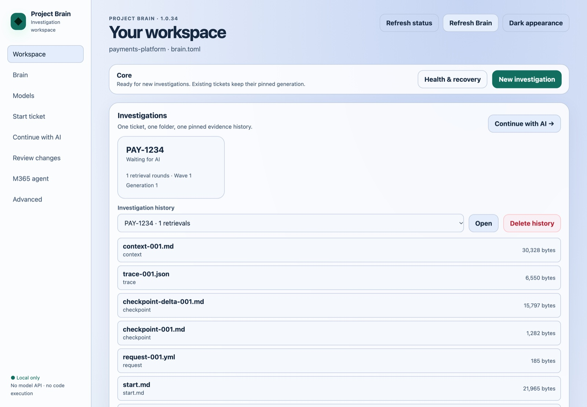

<div align="center">

# 🧠 Project Brain

**Give the chat AI your company already allows a safe, local codebase tool loop.**

Project Brain turns a ticket into verified source evidence from all of your
repositories, so Microsoft 365 Copilot, Claude or an IDE agent can propose a
concrete change. Everything runs on your machine, and your repositories stay read-only.

[](https://github.com/superorange0707/project-brain/actions/workflows/ci.yml)
[](https://github.com/superorange0707/project-brain/releases/latest)
[](pyproject.toml)
[](LICENSE)

[Install](#install) · [Quick start](#quick-start) · [Connect your AI](#connect-your-ai) · [User guide](docs/USER_GUIDE.md) · [How it works](docs/HOW_IT_WORKS.md)

</div>

---

```text
Ticket ──► Chat AI ──INVESTIGATION_REQUEST──► Project Brain ──► your repositories (read-only)
              ▲                                     │
              └──────── pinned source evidence ◄────┘
```



The AI does the reasoning; Brain does the searching. Each request is expanded
into exact source, callers, tests, configuration, Git history and
cross-repository links, and every piece of evidence is pinned to the snapshot
the ticket started from. You apply the resulting change in your own IDE.

- **Works with the AI you already have.** Microsoft 365 Copilot (file handoff),
  Claude Desktop, Claude Code, Cursor and JetBrains/VS Code agents (MCP), or any
  chat window (clipboard).
- **Many repositories, one investigation.** Java/Spring, Kafka, Feign, Python,
  configuration and JetBrains MPS models in the same evidence context.
- **Local and read-only.** No hosted service, no source upload by Brain, no
  build or test execution in your repositories.

## Install

| Platform | Command |
|---|---|
| macOS | `brew install superorange0707/tap/project-brain` |
| Windows 11 x64 | Installer below, or the portable [ZIP](https://github.com/superorange0707/project-brain/releases/latest) |
| Linux | `curl -fsSLO https://github.com/superorange0707/project-brain/releases/latest/download/install-project-brain.sh && sh install-project-brain.sh` |
| Python 3.11–3.14 | `uv tool install "project-brain-context @ git+https://github.com/superorange0707/project-brain.git@v1.0.35"` |

**Windows.** No administrator rights or Python are needed. Run the installer
from a temporary folder (on machines that block direct `.ps1` downloads, cloning
the tagged repository works):

```powershell
git clone --depth 1 --branch v1.0.35 https://github.com/superorange0707/project-brain.git project-brain-installer
```

```powershell
.\project-brain-installer\scripts\install-project-brain.ps1 -Version 1.0.35
```

It verifies the release ZIP against `SHA256SUMS.txt`, installs it under
`%LOCALAPPDATA%\ProjectBrain\bin` and adds that folder to your user `PATH`.
Offline and blocked-PowerShell options are in the
[User Guide](docs/USER_GUIDE.md#2-installation).

**Upgrading** from v1.0.35 onward is one command, run from your workspace:

```bash
brain upgrade
```

It stops the local UI when idle, upgrades through Homebrew or swaps a verified
standalone install, rebuilds the index only if the new version needs it, and
restarts the UI. v1.0.33 and older predate this command: upgrade them once with
`brew upgrade superorange0707/tap/project-brain` (after `brain ui stop`) or by
rerunning the Windows installer.

## Quick start

From the folder that contains your repositories:

```bash
brain init --name payments-platform
```

```bash
brain service install
```

`brain init` finds the Git repositories, takes read-only snapshots and builds the
local index; it writes only beside the repositories, never inside them.
`brain service install` starts the local UI now and again at every sign-in
(macOS LaunchAgent or Windows per-user startup, no administrator rights). On
Linux, or to start it just for this session, use `brain ui`.

Try everything on sample repositories first with `brain demo`.

## Connect your AI

**Microsoft 365 Copilot.** Create the Agent setup kit once and follow its
`SETUP.md`:

```bash
brain agent-kit m365
```

Then start each ticket in the UI (or `brain start TICKET --ticket-file ticket.md --target m365`)
and upload the handoff file it names. Brain tells you when the kit changes and
needs re-pasting; otherwise it never does.

**Claude Desktop, Claude Code, Cursor, JetBrains or VS Code agents.** Let the
agent call Brain directly over MCP, with no copying:

```bash
brain mcp config --host claude-desktop --write
```

Hosts: `claude-desktop`, `claude-code`, `vscode`, `cursor`, `jetbrains`. See
[Agents that call Brain directly](docs/USER_GUIDE.md#agents-that-call-brain-directly-mcp).

**Any other chat.** `brain start TICKET --ticket-file ticket.md` copies the
handoff to your clipboard; paste the AI's reply back with
`brain continue TICKET --clipboard`.

## Editions

| Edition | Adds | Needs |
|---|---|---|
| **Core** | Exact, lexical, structural, graph, history and ticket-experience retrieval | Nothing else |
| **Semantic** | Local semantic-card retrieval | `brain model install semantic` |
| **Precision** | Local candidate reranking | `brain model install precision` |

Model packs are optional, checksum-pinned and served only on `127.0.0.1`. See
[Model Pack Operations](docs/MODEL_PACKS.md).

## Privacy and safety

- Target repositories stay read-only; Brain never runs their code or tests.
- There is no hosted Project Brain service; model runtimes stay on `127.0.0.1`.
- The local UI listens on loopback only and uses a per-process token.
- Handoffs contain your source code. Share them only with AI services your
  company approves, and review them for secrets already in your repositories.

Read the [Security Policy](SECURITY.md) and [third-party notices](THIRD_PARTY.md)
before using Project Brain with private code.

## Documentation

| Document | Use it for |
|---|---|
| [User Guide](docs/USER_GUIDE.md) | Installation options, configuration, workflows, commands, troubleshooting |
| [How it works](docs/HOW_IT_WORKS.md) | Retrieval, pinning, refresh and UI behaviour in detail |
| [MPS and IPF evidence](docs/MPS_IPF.md) | JetBrains MPS model retrieval and flow navigation |
| [Model Pack Operations](docs/MODEL_PACKS.md) | Semantic and Precision packs: provenance, offline use, tuning |
| [Release Notes](RELEASE_NOTES.md) · [Changelog](CHANGELOG.md) | What changed |

## Contributing

Issues and focused pull requests are welcome; see [CONTRIBUTING.md](CONTRIBUTING.md).
Report vulnerabilities through a private GitHub Security Advisory, not a public issue.

## License

[MIT](LICENSE) © Project Brain contributors.
